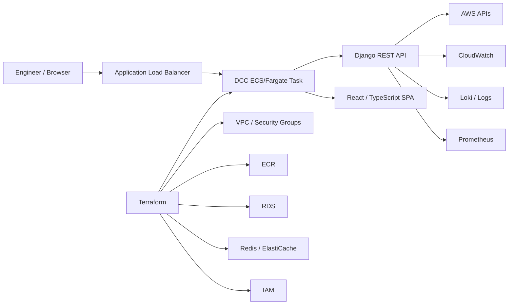

# DevOps Control Center (DCC)

[](https://github.com/faredmansour/dashboard_test/actions/workflows/ci.yml)
[](https://github.com/faredmansour/dashboard_test/actions/workflows/security.yml)
[](https://github.com/faredmansour/dashboard_test/actions/workflows/terraform.yml)

A production-oriented DevOps control plane for observing, testing, and diagnosing containerized workloads through a secure server-mediated architecture.

## What this project demonstrates

- **Cloud:** AWS ECS/Fargate, ECR, ALB, RDS, Redis/ElastiCache, CloudWatch, Cloud Map, IAM
- **Infrastructure as Code:** Terraform-managed networking, security groups, ECS, registries, data services, IAM and service discovery
- **Application:** Django + Django REST Framework backend with React + TypeScript frontend
- **Containers:** Multi-stage Docker build; one production image serving the frontend and API
- **CI/CD:** GitHub Actions for backend tests, frontend checks/build, Docker builds, Terraform validation and security scanning
- **Observability:** CloudWatch/Container Insights, Prometheus-compatible metrics, Loki log integration, health and diagnostic endpoints
- **Security:** least-privilege IAM, secret handling, target allowlists, SSRF-resistant controls, restricted headers, timeouts and bounded response sizes

## Architecture



The browser does not call AWS directly. Backend providers mediate AWS access and enforce configured targets and safety limits.

## Repository structure

```text
.
├── backend/                 # Django + DRF control plane
├── frontend/                # React + TypeScript + Vite
├── test-app/                # Standalone FastAPI test laboratory
├── infra/terraform/test-lab # AWS infrastructure as code
├── deploy/ecs/              # ECS deployment templates
├── docs/                    # Architecture, deployment and handoff docs
├── scripts/                 # Deployment/helper scripts
├── Dockerfile               # Production multi-stage image
└── .github/workflows/       # CI, security and Terraform automation
```

## CI/CD

Every pull request and push to `main` runs:

1. Django checks and backend tests
2. Frontend TypeScript typecheck and production build
3. Test App pytest suite
4. Production Docker image build
5. Terraform format and validation
6. Trivy filesystem/config security scanning

No AWS credentials are required by CI. Terraform validation uses `-backend=false`, and deployment credentials remain outside the repository.

## Local development

### Backend

```bash
cd backend
python -m venv .venv
# Windows PowerShell
.venv\Scripts\Activate.ps1
python -m pip install -r requirements.txt
python manage.py check
python manage.py test
python manage.py runserver
```

### Frontend

```bash
cd frontend
npm ci
npm run typecheck
npm run build
npm run dev
```

### Production Docker image

```bash
docker build -t dcc:local .
docker run --rm -p 8000:8000 \
  -e DJANGO_SECRET_KEY=replace-me \
  -e DJANGO_ALLOWED_HOSTS=localhost,127.0.0.1 \
  -e DCC_CORS_ALLOWED_ORIGINS=https://localhost:5173 \
  dcc:local
```

The production image packages the frontend build and Django backend together. Django serves `/`, `/assets/`, and `/api/*` from the same origin.

## Terraform

The AWS test-lab configuration lives in `infra/terraform/test-lab`.

```bash
cd infra/terraform/test-lab
terraform init
terraform fmt -check -recursive
terraform validate
```

The repository contains example configuration only. Do not commit real `terraform.tfvars`, backend credentials, AWS credentials, secrets, or state files.

## Security model

The project is designed around server-mediated access and bounded operations:

- AWS access is backend-only; the browser never receives AWS credentials.
- ECS targets are restricted to configured allowlists.
- Arbitrary URLs and Host headers are not accepted for controlled backend requests.
- Redirects, headers, request sizes and timeouts are bounded.
- Production secrets are supplied out-of-band through deployment mechanisms rather than source control.
- Docker images are scanned with Trivy in CI.
- IAM is used for AWS access instead of embedding credentials in application code.

## Documentation

Detailed architecture and operational documentation is available under [`docs/`](./docs/), including:

- architecture decisions and boundaries
- AWS network design
- deployment and runtime contracts
- diagnostic safety and operational guardrails
- API discovery and testing handoff
- observability and diagnostic impact notes

## Portfolio note

This repository is intended as a technical portfolio project demonstrating cloud-native application delivery, infrastructure as code, automation, observability and DevSecOps practices. It should not be interpreted as proof that every documented AWS environment is continuously running in production.
